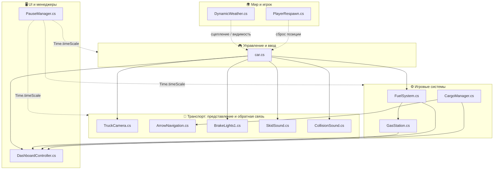
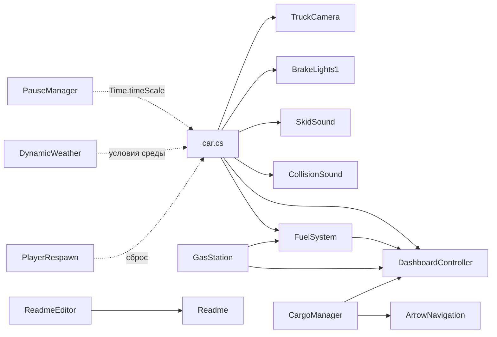
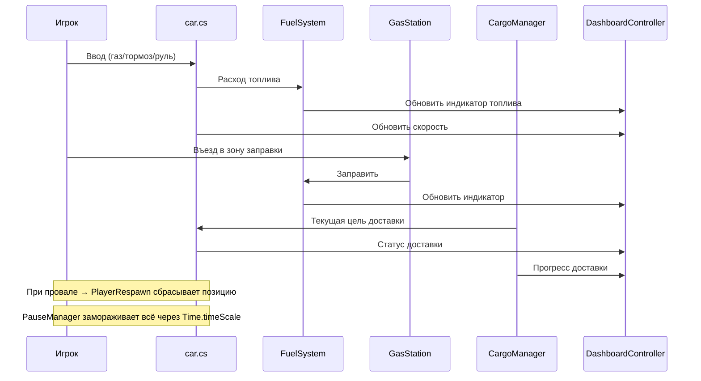

# 🚚 DeliveryGame

> Unity-проект: симулятор доставки грузов. Игрок управляет грузовиком, перевозит грузы между точками, следит за топливом, погодой и состоянием машины.


---

## 📑 Содержание

- [О проекте](#-о-проекте)
- [Стек технологий](#-стек-технологий)
- [Структура проекта](#-структура-проекта)
- [Архитектура](#-архитектура)
- [Основные модули](#-основные-модули)
  - [Транспорт и управление](#1-транспорт-и-управление)
  - [Игровые системы](#2-игровые-системы)
  - [Игрок](#3-игрок)
  - [Интерфейс и менеджеры](#4-интерфейс-и-менеджеры)
  - [Окружение](#5-окружение)
  - [Служебные скрипты](#6-служебные-скрипты)
- [Граф зависимостей](#-граф-зависимостей)
- [Потоки данных и игровой цикл](#-потоки-данных-и-игровой-цикл)
- [Соглашения проекта](#-соглашения-проекта)
- [Запуск проекта](#-запуск-проекта)
- [Заметка о достоверности данных](#-заметка-о-достоверности-данных)

---

## 📖 О проекте

**DeliveryGame** — игра про доставку грузов, построенная на Unity. Игрок выступает в роли водителя грузовика: берёт задания, перевозит груз по маршруту, расходует топливо, заправляется на станциях и сталкивается с динамически меняющимися погодными условиями.

Ключевые черты проекта:

- 🚛 **Физика и управление транспортом** — движение грузовика, следящая камера, звуковое сопровождение (визг шин, стоп-сигналы, столкновения).
- 📦 **Система доставки** — управление грузами, их регистрация и выдача.
- ⛽ **Топливная система** — расход топлива, заправка на станциях.
- 🌦 **Динамическая погода** — смена состояний атмосферы с плавными переходами.
- 🧭 **Навигация и UI** — указатель на цель, приборная панель, пауза.
- 🔁 **Возрождение игрока** — возврат в игровое состояние после неудачи.

---

## 🧰 Стек технологий

| Слой | Технология | Назначение |
|---|---|---|
| Движок | **Unity Engine** | Рендеринг, физика, сцены, префабы |
| Язык | **C#** | Вся игровая логика |
| Рантайм | **.NET / Mono (Unity Scripting Runtime)** | Исполнение скриптов |
| Физика | **Unity Physics (Rigidbody / Collider)** | Транспорт, столкновения, триггеры |
| Камера | **Unity Camera + скрипты следования** | Follow-камера за грузовиком |
| Аудио | **Unity AudioSource / AudioClip** | Звуки шин, тормозов, столкновений |
| UI | **Unity UI (uGUI)** + `DashboardController` | Приборная панель, меню паузы |
| Метео | **ParticleSystem / Light / Skybox** | Динамическая погода |
| Редактор | **UnityEditor (CustomEditor)** | Информационное окно Readme |

> ⚠️ Точные версии Unity, подключённые пакеты (Input System, TextMeshPro, Cinemachine) и настройки `ProjectSettings` по предоставленным данным не подтверждены — см. [Заметку о достоверности](#-заметка-о-достоверности-данных).

---

## 📂 Структура проекта

```text
My project/
├── Assets/
│   ├── Scripts/
│   │   ├── car.cs                    # Логика автомобиля (транспорт)
│   │   ├── TruckCamera.cs            # Следящая камера за грузовиком
│   │   ├── ArrowNavigation.cs        # Навигационный указатель на цель
│   │   ├── BrakeLights1.cs           # Стоп-сигналы
│   │   ├── SkidSound.cs              # Звук скольжения шин
│   │   ├── CollisionSound.cs         # Звук столкновений
│   │   ├── CargoManager.cs           # Менеджер грузов
│   │   ├── FuelSystem.cs             # Система топлива
│   │   ├── GasStation.cs             # Заправочная станция
│   │   ├── PlayerRespawn.cs          # Возрождение игрока
│   │   ├── PauseManager.cs           # Менеджер паузы
│   │   ├── DashboardController.cs    # Приборная панель
│   │   └── DynamicWeather.cs         # Динамическая погода
│   └── TutorialInfo/
│       └── Scripts/
│           ├── Readme.cs             # ScriptableObject с описанием проекта
│           └── Editor/
│               └── ReadmeEditor.cs   # Кастомный инспектор для Readme
└── ProjectSettings/                  # Настройки Unity-проекта
```

---

## 🏛 Архитектура

Проект следует классической **компонентной архитектуре Unity**: каждый скрипт — это `MonoBehaviour`, который навешивается на GameObject в сцене и отвечает за одну узкую зону ответственности.

Условно система делится на **пять слоёв**:



**Принципы связывания модулей:**

1. **Транспорт — центральный узел.** `car.cs` агрегирует зависимости от камеры, звуковых и световых модулей, топливной системы и панели приборов.
2. **Менеджеры — источники состояния.** `CargoManager`, `FuelSystem` и `DynamicWeather` хранят состояние и предоставляют его потребителям (UI, навигация, транспорт).
3. **UI — потребитель.** `DashboardController` только читает состояние систем и отображает его; он не управляет логикой.
4. **Глобальные переключатели.** `PauseManager` воздействует на все слои через `Time.timeScale`.
5. **Служебный слой** (`Readme`, `ReadmeEditor`) изолирован от рантайма и работает только в редакторе Unity.

---

## 🧩 Основные модули

### 1. Транспорт и управление

#### `car.cs`
**Роль:** ключевой игровой скрипт — реализация поведения автомобиля: управление, движение, физика и взаимодействие с грузом.

**Ожидаемые сущности:** класс-наследник `MonoBehaviour`, ссылки на `Rigidbody`/`WheelCollider`, параметры скорости, ускорения и поворота, обработка ввода в `Update`/`FixedUpdate`.

**В проекте:** центральный узел, от которого зависят камера, звук, свет и топливо.

---

#### `TruckCamera.cs`
**Роль:** следящая камера за грузовиком (follow camera).

**Ожидаемые сущности:** класс `TruckCamera : MonoBehaviour`, поле `Transform target`, настройки смещения, высоты и дистанции, сглаживание (`Lerp` / `SmoothDamp`), обновление позиции в `LateUpdate` (чтобы избежать «дрожания» относительно движения транспорта).

**Связи:** читает `Transform` грузовика → следует за ним.

---

#### `ArrowNavigation.cs`
**Роль:** навигационный указатель (стрелка), показывающий направление к цели — точке доставки или следующему объекту маршрута.

**Ожидаемые сущности:** расчёт направления между игроком и целью, поворот стрелки (`transform.LookAt` / кватернионы), работа с целевым `Transform`.

**Связи:** цель обычно задаётся `CargoManager` (текущая точка доставки).

---

#### `BrakeLights1.cs`
**Роль:** стоп-сигналы автомобиля — включение/выключение подсветки задних фонарей при торможении.

**Ожидаемые сущности:** ссылки на `Material` / `Renderer` / `Light`, переключение эмиссии или интенсивности по состоянию торможения.

---

#### `SkidSound.cs`
**Роль:** звук скольжения/визга шин (skid sound).

**Ожидаемые сущности:** `AudioSource`, `AudioClip`, детекция бокового скольжения колёс, регулировка громкости/питча в зависимости от силы скольжения.

---

#### `CollisionSound.cs`
**Роль:** аудио-обратная связь при столкновениях — контакт транспорта или груза с препятствием.

**Ожидаемые сущности:** обработчики `OnCollisionEnter` / `OnCollisionEnter2D`, обращение к `AudioSource` / `AudioClip`, возможно порог силы удара.

---

### 2. Игровые системы

#### `CargoManager.cs`
**Роль:** менеджер грузов — регистрация грузов, хранение их состояния, выдача/приёмка и привязка к доставке.

**Ожидаемые сущности:** контейнер списка грузов, методы выдачи/завершения доставки, точка назначения для `ArrowNavigation`.

**Связи:** → `ArrowNavigation` (цель), → `DashboardController` (статус доставки).

---

#### `FuelSystem.cs`
**Роль:** система топлива — текущий запас, расход при движении, заправка и сигнализация о низком уровне.

**Ожидаемые сущности:** поля `currentFuel` / `maxFuel`, метод расхода, метод заправки, флаг «топливо закончилось».

**Связи:** ← `car.cs` (расход), ← `GasStation.cs` (заправка), → `DashboardController` (индикатор).

---

#### `GasStation.cs`
**Роль:** заправочная станция — точка взаимодействия игрока с дозаправкой.

**Ожидаемые сущности:** детекция транспорта через `Collider`/`Trigger`, вызов заправки в `FuelSystem`, возможно списание денег и обновление UI.

**Связи:** → `FuelSystem`, → `DashboardController`.

---

### 3. Игрок

#### `PlayerRespawn.cs`
**Роль:** логика возрождения игрока — телепортация на точку старта после падения, столкновения с опасностью или провала доставки.

**Ожидаемые сущности:** `Transform` точки респауна, сброс позиции и состояния, возможно сброс скорости/топлива.

**Связи:** → сброс состояния `car.cs`.

---

### 4. Интерфейс и менеджеры

#### `DashboardController.cs`
**Роль:** приборная панель — отображение скорости, топлива и статуса доставки в UI.

**Ожидаемые сущности:** ссылки на UI-элементы (`Text` / `Image` / `Slider`), обновление в `Update`, подписка на изменения систем.

> В предоставленных данных саммари по этому файлу отсутствует — модуль описан по имени и месту в архитектуре.

---

#### `PauseManager.cs`
**Роль:** менеджер паузы — остановка игры и переключение состояния паузы.

**Ожидаемые сущности:** управление `Time.timeScale`, методы `Pause()` / `Resume()` / `TogglePause()`, показ/скрытие UI-панели паузы.

**Связи:** глобально влияет на все `MonoBehaviour`, зависящие от `Time.deltaTime`.

---

### 5. Окружение

#### `DynamicWeather.cs`
**Роль:** динамическая смена погоды — переключение состояний (ясно / дождь / снег / туман) с плавными переходами.

**Ожидаемые сущности:** массив пресетов погоды, интервалы смены, ссылки на `ParticleSystem`, `Light` / `LensFlare`, материал неба; вероятностный выбор следующего состояния.

**Связи:** влияет на визуальную вариативность мира и, возможно, на сцепление/видимость → `car.cs`.

---

### 6. Служебные скрипты

#### `Readme.cs`
**Роль:** служебный `ScriptableObject` из стандартного набора Unity Tutorial Info — контейнер для документации проекта, редактируемой через инспектор.

**Сущности:** класс `Readme : ScriptableObject`, поля `icon` (`Texture2D`), `title` (`string`), `sections` (`Section[]`); вложенный `[Serializable]` класс `Section` с полями `heading`, `text`, `linkText`, `url`.

**Связи:** используется только в редакторе.

---

#### `Editor/ReadmeEditor.cs`
**Роль:** кастомный инспектор для ассета `Readme` — рисует стилизованную «страницу приветствия» проекта в окне Inspector.

**Сущности:** класс `ReadmeEditor : Editor` с атрибутом `[CustomEditor(typeof(Readme))]`, стили (`GUIStyle`), методы `OnInspectorGUI`, `DrawSection`, `DrawHeader`, `DrawUILine`, `LoadLayout`.

**Зависимости:** `UnityEditor`, `UnityEngine`, данные из `Readme.cs`. На рантайм не влияет.

---

## 🕸 Граф зависимостей



**Легенда:**
- `→` — прямая зависимость (вызов / чтение данных).
- `-.->` — косвенное или ослабленное влияние.
- `ReadmeEditor → Readme` — связь только внутри редактора Unity.

---

## 🔄 Потоки данных и игровой цикл



**Жизненный цикл кадра:**

1. `Update` / `FixedUpdate` — обработка ввода и физики (`car.cs`).
2. Расчёт состояния систем (`FuelSystem`, `CargoManager`).
3. `LateUpdate` — синхронизация камеры (`TruckCamera.cs`) после движения транспорта.
4. `Update` UI — обновление `DashboardController`.
5. Асинхронно — смена погоды (`DynamicWeather.cs`), аудио-реакции (`SkidSound`, `CollisionSound`).

---

## 🧭 Соглашения проекта

| Правило | Описание |
|---|---|
| Один скрипт — одна ответственность | Каждый `MonoBehaviour` решает одну задачу |
| Разделение логики и представления | Менеджеры хранят состояние, UI его только отображает |
| Префикс `Manager` / `System` / `Controller` | Указывает на роль модуля в архитектуре |
| Наследование `MonoBehaviour` | Все игровые скрипты — компоненты GameObject |
| `ScriptableObject` для данных | `Readme` — пример хранения данных вне сцены |
| Изоляция редакторного кода | Папка `Editor/` — код, не попадающий в билд |

---

## ▶️ Запуск проекта

1. Установите **Unity Hub** и подходящую версию редактора Unity.
2. Клонируйте репозиторий:
   ```bash
   git clone <URL-репозитория>
   cd DeliveryGame
   ```
3. В Unity Hub добавьте папку проекта `My project` через **Add project from disk**.
4. Откройте проект и дождитесь импорта ассетов.
5. Откройте главную сцену и нажмите **Play**.

> Точная версия Unity и список сцен в предоставленных данных не указаны. Проверьте `ProjectSettings/ProjectVersion.txt`.

---

## ⚠️ Заметка о достоверности данных

Этот README составлен на основе:

- имён и путей файлов проекта;
- данных парсера по каждому файлу;
- контекста проекта (Unity + C#, игра про доставку).

**Важно:** при анализе инструмент чтения не смог получить содержимое файлов (пути оказались вне разрешённой директории), поэтому извлечённые структуры (импорты, классы, методы) оказались пустыми для всех скриптов. Как следствие:

- названия классов, полей и методов указаны как **ожидаемые по конвенции Unity** и требуют подтверждения;
- граф зависимостей построен по **логике предметной области** (транспорт → топливо → заправка → UI), а не по результатам статического анализа;
- версии Unity, пакеты и настройки сцен не проверены.

Для получения точной документации рекомендуется повторно проанализировать файлы с корректно заданным корнем проекта (`base_dir`), после чего обновить разделы [Основные модули](#-основные-модули) и [Граф зависимостей](#-граф-зависимостей).

---

<div align="center">

**DeliveryGame** — довези груз, не заглохни, не попади в бурю. 🚚💨

</div>